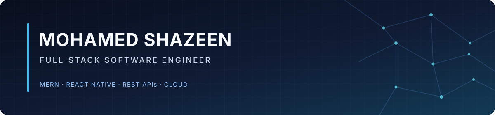

  

  <h1>
    Hi there, I'm Mohamed Shazeen 
  </h1>
  
  <!-- Animated Typing Text -->
  

  
<em>Building reliable backend systems, thoughtful interfaces, and seamless integrations that support real business workflows.</em>

  <!-- Premium Linked Social Buttons -->
  

    
    
    
    
  

 

## 👨‍💻 About Me

I'm a Full-Stack Software Engineer with **3+ years of professional experience** working across frontend, backend, mobile, and cloud deployment. My expertise spans building scalable applications, robust data layers, and seamless mobile experiences. I highly value maintainable code, clear engineering practices, and dependable application behavior in production environments.

<table align="center" width="100%">
  <tr>
    <td width="50%" valign="top">
      <h3>⚙️ Engineering & Architecture</h3>
      <ul>
        <li>🚀 <strong>Full-Stack:</strong> End-to-end web & mobile apps</li>
        <li>🔌 <strong>Backend:</strong> REST API design & service integration</li>
        <li>🔐 <strong>Security:</strong> Auth, OTP & role-based access (RBAC)</li>
        <li>💳 <strong>Workflows:</strong> Payment & transaction pipelines</li>
      </ul>
    </td>
    <td width="50%" valign="top">
      <h3>🛠️ Delivery & Operations</h3>
      <ul>
        <li>🔄 <strong>Methodology:</strong> Agile / Scrum collaboration</li>
        <li>📦 <strong>CI/CD:</strong> Git, GitLab & automated pipelines</li>
        <li>⚡ <strong>Quality:</strong> Testing, debugging & performance</li>
        <li>☁️ <strong>Cloud:</strong> Deployment & system maintenance</li>
      </ul>
    </td>
  </tr>
</table>

## 💻 Premium Technology Stack

  
<strong>Languages & Core</strong>

  
  
    
  
 
<strong>Frontend & Mobile</strong>

  <a href="https://skillicons.dev">
    <!-- Replaced 'android' with 'androidstudio' -->
    
  </a>
  
    

  
<strong>Backend & Databases</strong>

  

    

  
<strong>Cloud, DevOps & Tools</strong>

  

 

## 📊 GitHub Analytics

  
  

 

## 💼 Professional Experience

> **Software Engineer** @ Seylora IT Solutions  
> *March 2026 – Present*
> * Building and maintaining full-stack web and mobile applications, REST APIs, and seamless third-party integrations.
> * Managing GitLab CI/CD workflows, handling production troubleshooting, and continuously optimizing application reliability.

> **Software Engineer** @ Zaas Labs  
> *June 2023 – February 2026*
> * Developed dynamic web and mobile application features, robust REST APIs, and system integrations.
> * Actively contributed to Agile software delivery teams, executing bug fixes and significant performance improvements.

> **Visiting Lecturer** @ Informatics Institute of Technology  
> *September 2024 – September 2026*
> * Delivered comprehensive programming and software engineering lectures.
> * Provided practical guidance in debugging, technical problem-solving, and student project execution.

## 🎓 Education

- 🎓 **BEng (Hons) in Software Engineering** — University of Westminster, UK *(awarded through IIT)* (2020–2023)
- 💻 **Full Stack Development (MERN Stack)** — University of Colombo School of Computing (2024)

---

## 🌍 Open To...

Full-stack engineering, React Native/mobile development, backend/API engineering, and software integration opportunities. Based in Sri Lanka and **open to international relocation**.

  <h3>Let's build something amazing together!</h3>
  

